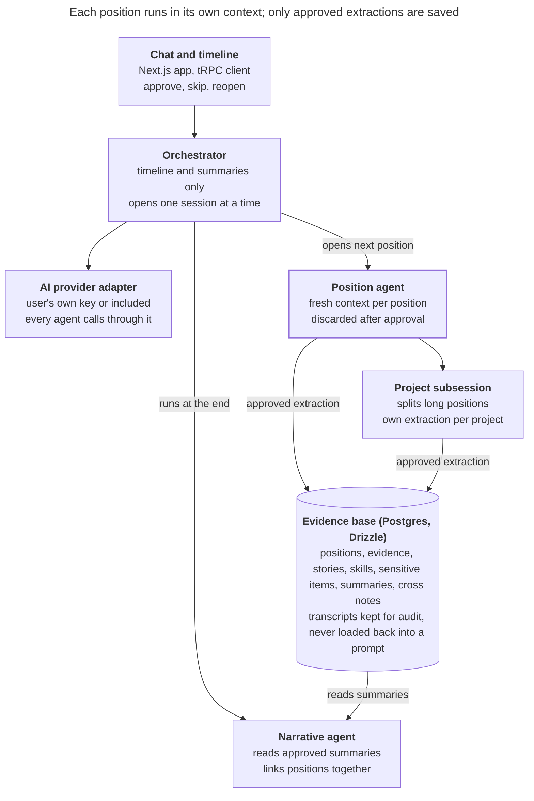

# StoryToRole spec: Guided career interview

Nov 13, 2026 · @Guilherme

## Goal and scope

The career interview turns a user's working life into a structured, user-approved evidence base. Every resume and cover letter in StoryToRole is generated from it, and nothing outside it.

It replaces two manual steps of the meu-emprego-novo CLI: writing `profile_truth.md` by hand and pasting an AI interview transcript into `about_me.md`. It also fixes their cost problem: today the whole profile is resent on every agent call.

**In the MVP**

- Import of one or more resumes (PDF or DOCX) to pre-fill the career timeline; positions can also be added by hand or proposed by the interview.
- Guided interview, one position at a time, in what feels like a single conversation; resumable at any point.
- Extraction of evidence, stories, skills and sensitive items, approved by the user before saving.
- Sensitive-data choices per item (use, generalize, exclude), with per-application overrides.
- A career narrative that links positions together.
- Interface and AI conversation in English or Brazilian Portuguese, typed or spoken (speech to text).

**Out of the MVP**

- Job search and auto-apply (never planned).
- LinkedIn optimization, spoken AI replies (text to speech), team or recruiter accounts.
- Hiring interview prep (practice questions and talking points for an employer's interview). In StoryToRole, "interview" always means this career interview.

**In the MVP, out of this spec**

- Fit assessment, resume and cover letter generation, and the tracker. Each gets its own spec; this one defines the data they consume.

## Principles

Five rules shape every decision below; when a design choice conflicts with one, the rule wins.

1. **One position at a time.** A position is closed and approved before the next one opens. Mentions of other positions are noted, not discussed.
2. **The AI invents nothing.** The AI only records what the user said or uploaded. Every saved fact keeps a link to its source turn or document. StoryToRole does not judge whether what the user states is true: the user is responsible for how they use the tool.
3. **The user approves what is saved.** Extraction is a proposal; nothing reaches the evidence base without explicit approval, and every item stays editable.
4. **Code enforces, the AI suggests.** Sensitive-data choices, locked facts (employers, titles, dates) and forbidden terms are applied in code before and after each AI call, never left to a prompt.
5. **Bounded context.** No AI call carries the whole career. Each call gets only the slice it needs, so cost per turn does not grow with career length.

## User experience

The user sees one continuous chat with a career timeline beside it; behind it, each position is its own session.

1. **Choose languages.** Interface language and interview language are separate settings (English or Brazilian Portuguese). A user may browse in Portuguese and answer in English when targeting foreign roles. Both default to the browser locale. In every chat the user can type or tap a microphone button and speak; the transcript lands in the input box to edit before sending.
2. **Privacy notice.** Before the first question: what goes to the AI provider, what to avoid saying (client data under NDA, salaries, other people's personal data, health and family), and that sensitive items can be hidden later.
3. **Import.** The user uploads one or more resumes, now or at any later point. The system merges them into one draft timeline: the same position found in several files becomes one entry, and conflicting titles or dates are shown side by side for the user to pick. With or without files, the user can add, edit, merge or remove positions on the timeline.
4. **Interview, position by position.** Most recent first by default; the user can pick another. The timeline shows each position as pending, in progress or approved. When the conversation reveals a missing position (a short contract, a promotion worth its own entry) or one that should go (a duplicate, an internship the user wants out), the interviewer proposes the change; it applies only after the user confirms.
5. **Close a position.** The interviewer proposes the extracted evidence, stories, skills and sensitive items. The user edits, approves or asks for another round of questions.
6. **Sensitive-data review.** Right after approval, the user chooses use, generalize or exclude for each flagged item.
7. **Career narrative.** After all positions are approved (or whenever the user asks), the system drafts the links between positions for approval.
8. **Come back anytime.** Leaving mid-position keeps progress. Reopening an approved position starts a new session seeded with what was approved.

The chat language follows the interview language setting; extracted data is stored in the language it was told in and translated at generation time, never at extraction.

The interview language can change at any time and takes effect from the next turn; most users will keep one language for the whole interview. Each evidence item keeps the language it was told in. The approval screen and the timeline show a small language badge (EN/PT) on each item only when the career holds evidence in both languages.

## Architecture

The user sees one conversation; the system runs a light orchestrator and one short-lived agent context per position, with the database as the only shared memory.

The orchestrator never holds turns, only the timeline and approved summaries. A position agent's context lives until the user approves its extraction, then it is discarded. Long positions split into project subsessions that close the same way. The narrative agent runs last and reads summaries only. A plain loop with one session per position is enough; no agent framework is required.

## Stack, languages and AI providers

StoryToRole starts from a clone of the private `gmonte/company-balance` repo, which already provides the app shell, auth, database and i18n.

| Layer | Comes from the base repo | Added for the interview |
| --- | --- | --- |
| Monorepo | pnpm workspace with lerna and nx; `apps/web`, `packages/api`, `packages/common`, `packages/intl`, `packages/web` | A `packages/ai` package for prompts, agents and provider adapters |
| Web app | Next.js App Router, shadcn/ui components | Chat view with streaming, timeline panel, approval and sensitive-data screens |
| API | tRPC routers plus a REST bridge and Swagger docs | `interview`, `positions`, `evidence`, `sensitiveItems` routers |
| Database | Postgres with Drizzle schemas per domain and generated migrations | Tables from the data model section |
| Auth | Clerk, synced to local `users` through webhooks | Ownership checks on every interview record |
| i18n | `@repo/intl`, locale from a cookie, `useTranslation` and `getTranslation` | English and Brazilian Portuguese messages; a separate interview-language setting per user |
| Tests | Vitest, PGlite for database tests | Tests for context building, sensitive-data filtering and extraction approval |
| AI processing | None | Every AI call (interview turns, extraction, generation, fit checks, embeddings) runs as a Trigger.dev task; progress and tokens are streamed to the client through Trigger.dev Realtime, and results are saved to Postgres |
| Rate limiting | None | Upstash Redis (free tier: 256 MB, 500K commands a month; then pay as you go) for rate limits and the misuse cooldown, through `@upstash/ratelimit`. Credit balances and every result stay in Postgres |

**Interface language** uses the existing `@repo/intl` setup. **Interview language** is stored on the user and passed to every prompt; prompts are written in English with an instruction to converse in the chosen language.

**AI providers.** Two modes share one adapter interface:

- **Bring your own key:** the user picks a provider and a model from a tested list and enters an API key. Keys live on the server only, since calls must pass the guardrails and generation runs in the background. Each key is encrypted with AES-256-GCM before it reaches the database, under a master key held in its own environment variable (separate from the database URL, marked sensitive in the deploy). Every encrypted key records the master-key version, and a script re-encrypts all keys when the master key rotates. A saved key is never shown again (only its last characters), is decrypted in memory only for the call, is masked by the logger, is validated with a minimal provider call when saved, and is deleted on revoke. A managed key vault (KMS) is deferred until paying users or compliance require it.
- **AI included:** StoryToRole's own key, with monthly limits per plan.

The adapter reports token usage per call so the app can show cost estimates before a run and actual usage after.

**Voice input.** Speech to text only, like the Claude app's dictation: the user speaks, the transcript appears in the input box, and nothing is sent until they confirm. The transcription language follows the interview language. Audio is not stored; only the confirmed text becomes an interview turn.

Recognition runs on the user's device only. The microphone button uses the browser's Web Speech API with on-device processing requested (`processLocally`); the browser downloads the language pack once and audio never leaves the device. Where on-device recognition is unavailable (checked at runtime with `SpeechRecognition.available()`; for example Firefox, ChromeOS or a language pack that failed to download), the button is replaced by a hint on using the operating system's own dictation (Fn Fn on macOS, Win+H on Windows, the keyboard microphone on iOS and Android), which types into the input box like any keyboard. StoryToRole never sends audio to a server, its own or a third party's, so voice input costs nothing and is part of every plan. A paid transcription API is reconsidered only if on-device quality in Brazilian Portuguese disappoints in testing.

The privacy notice says audio never leaves the user's device.

## Interview script per position

The interviewer follows six stages per position, asks one question at a time, and digs deeper until each stage has concrete evidence or the user says there is none.

| Stage | Asks about | Done when |
| --- | --- | --- |
| 1. Confirm | Employer, title, dates, location, employment type; title changes inside the company | The user confirms the imported facts or corrects them |
| 2. Context | What the company does, its size and sector, the team, who the user reported to and who reported to them | The scale of the role is clear |
| 3. Projects | The main projects or responsibilities, one at a time; each becomes a subsession when the position is long | Every project the user wants to keep is listed |
| 4. Stories | For each project: the problem, what the user did, with whom ("in partnership with"), the result | Each story has an action owned by the user and a result |
| 5. Evidence | Numbers (before and after, scale, time, money, people), tools and technologies actually used, awards | Every claim has a number, a scope or an explicit "no number" |
| 6. Boundaries | What must never appear, client names, confidential figures, internal codenames | Sensitive items are flagged for review |

**Behaviour rules**

- The user is the subject of every story; partners are credited at the end ("in partnership with the data team").
- No leading questions that suggest achievements. The interviewer asks "what happened next?", never "did that increase revenue?".
- Vague answers get one follow-up asking for a concrete example; a second vague answer is recorded as is, marked low-detail.
- When the user mentions another position, the interviewer notes it for that position and returns to the current one.
- The user can say "skip", "come back later" or "I'm done with this position" at any time.

## Agent tools

Agents change state only through these tools; each one is a tRPC procedure that checks ownership and validates input with a schema.

| Tool | Used by | What it does |
| --- | --- | --- |
| `get_position_context` | Position agent | Returns the timeline skeleton, neighbour summaries and what is already known about this position |
| `save_draft_fact` | Position agent | Stores a fact as a draft with its source turn id; drafts are not evidence until approved |
| `flag_sensitive_item` | Position agent | Marks a client, project codename, figure or person for the sensitive-data review |
| `note_for_position` | Position agent | Leaves a note on another position; reopens it if it was already approved |
| `open_subsession` / `close_subsession` | Position agent | Splits a long position by project; closing triggers extraction for that project only |
| `propose_extraction` | Position agent | Builds the approval screen from the drafts of the session |
| `close_position` | Orchestrator | Called after the user approves; writes evidence, stores the summary, discards the session context |
| `next_position` | Orchestrator | Picks the next position (user choice first, then most recent pending) and opens a fresh session |
| `draft_narrative` | Narrative agent | Reads approved summaries only and proposes the links between positions |

**Timeline changes.** These tools only create a proposal card in the chat; the change applies when the user confirms it.

| Tool | Used by | What it proposes |
| --- | --- | --- |
| `propose_add_position` | Position agent, orchestrator | A new position with employer, title and dates, inserted in chronological order |
| `propose_remove_position` | Position agent, orchestrator | Removing a position; its evidence is kept hidden so the removal can be undone |
| `propose_merge_positions` | Orchestrator | Joining duplicates, for example the same position imported from two resumes |
| `propose_split_position` | Position agent | Splitting one entry in two, for example a promotion with a new scope |
| `propose_resolve_conflict` | Orchestrator | Choosing between conflicting titles or dates found in different resumes |

The user can trigger the same actions from the UI (approve, skip, reopen); the agent never approves on the user's behalf.

## Data model

The evidence base is relational and owned by one user; transcripts are kept for audit but no AI call reads them back.

| Table | Key fields | Notes |
| --- | --- | --- |
| `career_profiles` | user id, interview language, status | One per user in the MVP |
| `source_documents` | profile id, file name, extracted text, uploaded at | One or more imported resumes, uploaded at any time; raw text stays here |
| `positions` | profile id, employer, title, start, end, location, status (pending, in progress, approved, removed), origin (imported, manual, interview), source document ids, order | Employer, title and dates are locked facts once approved; removal is soft, so evidence can be restored |
| `projects` | position id, name, period, status | Subsessions of long positions |
| `interview_sessions` | position id, project id (optional), status, token usage | One per conversation slice; closed sessions are never reloaded |
| `interview_turns` | session id, role, content, language, created at | Audit trail and source links |
| `evidence` | position id, project id, kind (achievement, responsibility, metric, tool, award), text, language, source turn ids, approved at | The only facts generation may use |
| `stories` | position id, problem, action, partners, result, evidence ids | Problem, action, result stories that feed resume bullets and cover letters |
| `skills` | profile id, name, evidence ids | A skill without linked evidence is not usable |
| `sensitive_items` | position id, kind (client, codename, figure, person), original text, choice (use, generalize, exclude), generalized text | Default choice: generalize for clients and figures |
| `application_overrides` | sensitive item id, application id, choice, generalized text | Per-application exceptions to the item's general choice |
| `position_summaries` | position id, summary, version | 150 to 300 words; what the orchestrator and neighbours see |
| `cross_notes` | from position id, to position id, text, resolved | Mentions of other positions |
| `career_narrative` | profile id, text, themes, version, approved at | Links between positions |

Following the base repo, each table lives in its domain under `packages/api/src/domains/*/db`, and migrations are generated by Drizzle.

## Sensitive-data control

The user decides, item by item, which names and figures the AI may use; code applies the choice, so an excluded name never reaches a generation prompt.

| Choice | Before the AI call | After the AI call |
| --- | --- | --- |
| Use | Sent as is | No check |
| Generalize | Replaced by the generalized text (suggested by the AI, edited by the user) | The original text is a forbidden term; output containing it is rejected and regenerated |
| Exclude | Removed from every fact that mentions it; facts that make no sense without it are left out | Same forbidden-term check |

Example: "Banco X" becomes "the largest private bank in the country, headquartered in Osasco"; "R$ 12 million in savings" becomes "eight-figure savings"; "Project Phoenix" is excluded.

**Scope.** The control covers names and explicit figures only. A public description that lets a reader infer the company is acceptable, and there is no re-identification check.

**Per-application overrides.** Each sensitive item's choice is the general rule and applies to every application, so the user sets it once. On a given application, the user can hide an item that is normally used (applying to a competitor of a client) or reveal one that is normally generalized.

**What it does not cover.** During the interview itself, what the user types goes to the AI provider; the privacy notice says so before the first question.

## Context and token management

Approved extraction is the compaction: context is cut at checkpoints the user confirms, not when a window fills up.

**What each call carries**

| Call | Context |
| --- | --- |
| Orchestrator | Timeline (employer, title, dates, status) and position summaries |
| Position agent | Instructions, timeline skeleton, summaries of the previous and next positions, known facts for this position, notes from other positions, and the current session's turns |
| Subsession (project) | The same, plus summaries of already closed projects of this position instead of their turns |
| Narrative agent | Approved position summaries and the career timeline |
| Generation (resume, cover letter) | Only the evidence relevant to the opening, after sensitive-data filtering |

**Rules**

- A session's size is measured in tokens of its turns, not in turn count, since one long dictated answer can weigh as much as ten short ones. Past a set threshold N the interviewer proposes a session checkpoint: extract what was said so far, ask for approval, continue in a fresh session. The user may postpone it; at 2N the checkpoint is mandatory. The rule is the same whether tokens are paid by StoryToRole or by the user's own key. N is a setting to tune with real usage (starting point: about 20k tokens).
- Stable parts of a prompt (instructions, timeline, summaries) come first so provider prompt caching applies; on Anthropic models cached input is billed at roughly a tenth of the normal rate.
- Token usage is stored per session and per user, which feeds the cost estimate shown before generation and the plan limits for AI-included plans.

**Target to measure:** cost per interview turn stays flat whether the user has 2 positions or 20.

## Integration with generation

Every later feature reads the evidence base through one function that selects, filters and formats evidence for a given opening.

| Feature | Reads | Comes from meu-emprego-novo |
| --- | --- | --- |
| Fit assessment | Opening description, skills, evidence kinds, timeline | New (gap identified against Rolevera) |
| Tailored resume | Locked facts, relevant evidence, narrative | Strategist, hiring manager and editor loop; best-rated version kept; locked facts and length rules from `policy.py` |
| Cover letter | Narrative, top stories for the opening | New |
| Evidence trace | Source turn ids on each evidence item | New: each generated line links back to what the user said |

Generated text is written in the output language the user picks, adapting evidence stored in another language (see [resume-and-cover-letter.md](./resume-and-cover-letter.md)). Forbidden terms from the sensitive-data control are checked on every output.

## Usage guardrails

StoryToRole is not a general chatbot: every AI call must serve the interview or a generation, and code, not the prompt alone, stops anything else before it reaches an expensive model.

Each user message passes these layers in order; the first one that fails answers from code, with no call to the main model.

1. **No general-purpose chat.** Every chat belongs to a context: the career interview, an opening or a document. There is no chat without an owner and no "ask anything" box. The topic gate judges each message against its context.
2. **Input limits in code.** Maximum characters per message, maximum voice-recording length, maximum file size and pages per upload, maximum opening-description length.
3. **Topic gate.** A small, cheap model classifies each message as on topic (career, the current position, the interview itself), off topic, or an attempt to override instructions. Off-topic messages get a fixed reply in the interview language that steers back to the current question.
4. **Content checks on inputs that trigger generation.** An upload must look like a resume and a pasted opening description must look like a job posting; anything else is refused before generation, so the generation flow cannot be used as a free writing tool.
5. **Scoped prompts and tools.** The main model's instructions limit it to the interview, and it has no tools beyond those in this spec: no web access, no code execution. Links the user attaches are read by code, not by the model (see the workspace spec).
6. **Output limits.** A maximum number of output tokens per call, set per call type.
7. **Budgets and rate limits.** Session size (see session checkpoints), sessions per day, and a monthly usage allowance per plan, enforced before each call. The user sees a usage meter; at the limit the app stops calling the AI and offers an upgrade or an extra pack.
8. **Repeated misuse.** Off-topic and override attempts are counted; after a set number in a short window the chat pauses for a cooldown.
9. **Monitoring.** Cost per user per day is tracked, with an alert for outliers.

**Bring-your-own-key users** pay for their own tokens, so the usage allowance does not stop them; their usage and estimated cost are shown as information only. Every other guardrail applies, session checkpoints included: the terms of use cover the product's purpose, and the topic gate runs on StoryToRole's key so it cannot be skipped.

Thresholds (message length, turns, budgets, cooldown) are settings to tune with real usage, not fixed in this spec.

## Risks, open questions and acceptance criteria

**Risks**

| Risk | Mitigation |
| --- | --- |
| Users drop out of a long interview | Resumable sessions, visible progress on the timeline, value shown early (first position approved yields a usable summary) |
| The AI embellishes during extraction | Source turn ids on every fact; approval screen shows the user's own words beside each extracted line |
| A weak model chosen with a user's own key gives poor interviews | Only tested models are offered |
| Leaked API keys | Encryption at rest, no logging, one-click revoke |
| Personal data under LGPD | Privacy policy, account deletion that removes transcripts and evidence, data not used for training |

**Open questions**

None at the moment.

**Acceptance criteria**

- [ ] A user with an imported resume completes and approves one position in a single session.
- [ ] Two resumes listing the same position produce one timeline entry; conflicting dates are shown for the user to pick.
- [ ] The user can add, edit, merge and remove positions on the timeline without uploading a file.
- [ ] A position added, split, merged or removed by the interviewer changes the timeline only after the user confirms.
- [ ] A removed position can be restored with its evidence.
- [ ] Leaving mid-position and returning resumes at the same stage, without repeating questions.
- [ ] No AI call contains turns from a closed session.
- [ ] An item marked exclude never appears in any prompt sent after the choice.
- [ ] Output containing a generalized or excluded original is rejected.
- [ ] Interface and interview language can be set independently to English or Brazilian Portuguese.
- [ ] Token usage is recorded for every call.
- [ ] An off-topic message (a recipe, code help, a general question) gets a fixed reply and makes no call to the main model.
- [ ] A message asking the AI to ignore its instructions is blocked the same way.
- [ ] A file that is not a resume, or a pasted text that is not a job posting, is refused before generation.
- [ ] At the monthly budget, no further AI call is made and the user sees the limit and the upgrade options.
